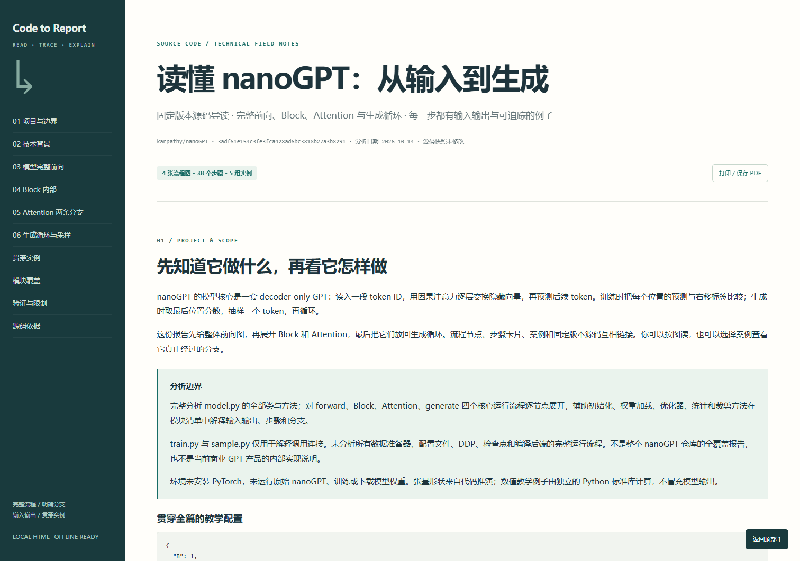

# Code to Report · 把代码讲清楚

**从源码到完整流程图，再到每一步的输入、输出、分支和例子。**

An Agent Skill for source-grounded, offline HTML technical reports with complete flowcharts, module I/O, branch explanations, and end-to-end examples.

适合：论文复现、接手陌生仓库、vibe coding 后回头理解项目、开发交接和技术学习。默认中文，可按请求使用其他语言。

## 看演示

下载仓库后，用浏览器打开 **[nanoGPT 演示报告](examples/nanogpt/report.html)**。这是已经填充的源码报告，不是占位页面。GitHub 文件浏览器不会直接运行 HTML；可下载查看，或自行启用 GitHub Pages 后打开对应路径。



[查看完整前向流程图预览](docs/flow-preview.png)

演示基于 [karpathy/nanoGPT](https://github.com/karpathy/nanoGPT) 固定提交 `3adf61e154c3fe3fca428ad6bc3818b27a3b8291`：

- 完整前向、Block、Attention 和生成循环 4 张图，38 个步骤。
- 每步的作用、输入输出、实现细节、具体例子和源码行号。
- 5 组案例：训练前向、长上下文+top-k、无 top-k、超长失败、零次生成。
- 案例路径高亮、节点跳转、各步具体数据、图形缩放、源码摘录、打印样式。
- model.py 的初始化、预训练加载、优化器、裁剪和统计方法另有模块说明。

**演示分析范围：**完整 model.py 模型核心；train.py / sample.py 只解释调用连接。未在此环境运行 PyTorch、下载模型权重或训练。张量形状为源码推演，数值注意力与概率为独立教学计算。请勿把演示当成模型实测或全仓库审计。

## 安装

### Codex

项目级：把仓库放到项目的 `.agents/skills/code-to-report/`，保证该目录下直接有 SKILL.md。

```text
your-project/
└── .agents/skills/code-to-report/
    ├── SKILL.md
    ├── references/
    ├── assets/
    └── scripts/
```

也可以在 Codex 中要求内置安装器从你发布的 GitHub 仓库安装：

```text
$skill-installer 从 https://github.com/OWNER/code-to-report 安装这个技能。
```

把 OWNER 改为发布者账号；如果 skill 位于仓库子目录，提供该目录的 GitHub URL。不同版本用户级目录可能不同，优先使用宿主安装器。[Codex 官方技能说明](https://learn.chatgpt.com/docs/build-skills)

### WorkBuddy

通过“技能 → 添加技能 → 上传技能”导入技能包。[WorkBuddy 官方说明](https://www.codebuddy.cn/docs/workbuddy/From-Beginner-to-Expert-Guide/Function-Description/Skills-Market)

可运行下面的打包脚本生成 `dist/code-to-report-skill.zip`。包根目录包含 SKILL.md，不包含庞大的演示资料。具体导入结构和选择语法以当前宿主版本为准；本仓库未在 WorkBuddy 中实际导入测试。核心指令与模板可共用，文件访问、执行和浏览器能力取决于宿主。

```sh
python scripts/package_skill.py
```

## 一句话使用

```text
使用 code-to-report，分析当前项目，生成中文 HTML 技术报告。
```

CLI/IDE 支持时可用 `$code-to-report` 显式调用。只需要补每次变化的项目路径、读者和重点，不必重复报告规范。

```text
使用 code-to-report，分析 ./my-project，面向第一次接触该项目的开发者。
```

论文复现：

```text
使用 code-to-report，分析当前代码，对照我提供的论文解释公式和方法怎样实现，标出实现差异。
```

默认输出 `reports/technical-report.html`，用户指定位置或宿主输出目录约定优先。

## 内容要求

| 内容 | 要求 |
|---|---|
| 完整流程 | 入口、主路径、重要分支、回路、失败与输出；复杂项目分层但不丢分支 |
| 每步解释 | 目的、输入、内部细节、输出、副作用、条件、例子、源码依据 |
| 贯穿实例 | 同一输入走到底；关键分支补例子；逐步展示变化 |
| 技术背景 | 问题、原理、实际用法、参数与限制 |
| 证据 | 真实文件/符号/行号；区分实测、静态推演、教学例子和未知 |
| 论文对照 | 论文步骤/公式到实现与配置的映射，明确调整或缺失 |
| 载体 | 离线 HTML，内联 SVG/CSS/必要 JS，目录和打印支持 |

例子和结构检查不能证明实现完全正确。skill 也不能替代宿主模型的源码理解能力；大项目仍需要合理的阅读范围和足够上下文。

## 文件结构

```text
code-to-report/
├── SKILL.md                      # 核心工作流，自动匹配所用的描述
├── agents/openai.yaml            # Codex 展示信息，可选
├── references/                   # 证据、内容契约、论文与渲染格式
├── assets/report-template.html   # 离线排版与交互外壳
├── scripts/build_report.py       # JSON → HTML；Python 标准库
├── scripts/package_skill.py      # 生成精简技能 ZIP
├── tests/                        # 渲染与打包行为验证
└── examples/nanogpt/             # 实际演示数据、构建器、报告、固定源码
```

渲染器可选：没有 Python 的宿主可以按内容契约直接生成等价 HTML。无需密钥、MCP 服务、CDN、浏览器扩展或联网渲染。

## 开发与复建

```sh
python examples/nanogpt/build_demo.py
python scripts/build_report.py examples/nanogpt/report-data.json --validate-only
python -m unittest discover -s tests -v
python scripts/package_skill.py
```

数据格式见 [renderer-format.md](references/renderer-format.md)。修改 HTML 模板后重新生成演示，再在浏览器检查；结构通过不表示语义和布局必然正确。当前验证记录见 [VALIDATION.md](VALIDATION.md)。

## 发布到 GitHub

这个文件夹本身可作为仓库根目录。选择仓库名 `code-to-report`，上传后替换安装示例中的 OWNER，即可分享技能与演示。维护稳定 tag 方便固定版本，正式推广时可另外适配各宿主的插件分发格式。报告不会自动上传或公开。

## 许可与出处

本项目原创指令、模板与脚本使用 [MIT](LICENSE)。`examples/nanogpt/source/` 保留的上游代码属于 nanoGPT，按其 [MIT 许可证](examples/nanogpt/source/LICENSE) 分发，并保留 Andrej Karpathy 署名。固定版本和文件 SHA-256 见源码目录中的 provenance.json。

采用 [Agent Skills 开放格式](https://agentskills.io/specification)。本仓库与 OpenAI、腾讯、nanoGPT 作者没有官方隶属关系。
